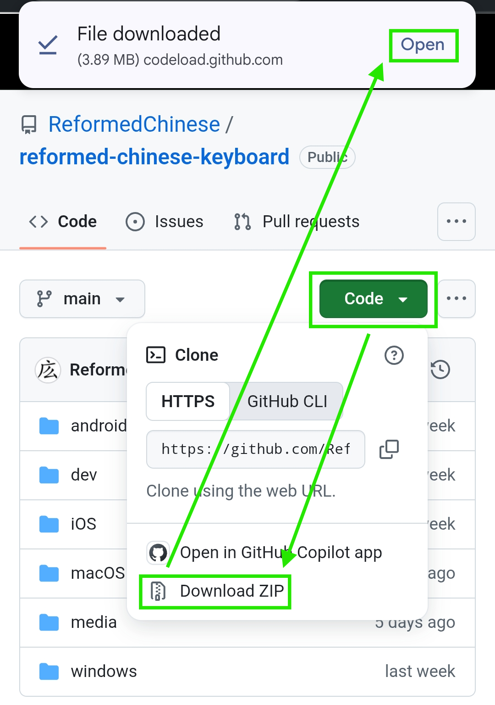
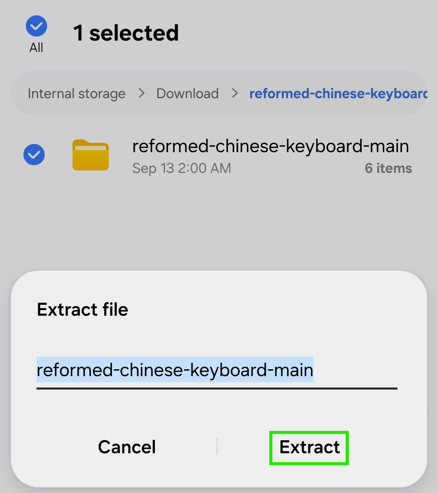

# Reformed Chinese Keyboard for iOS Installation Guide

### Step 1: Download this GitHub repo

On this GitHub repo [reformed-chinese-keyboard](https://github.com/ReformedChinese/reformed-chinese-keyboard), tap the green `Code` button and then tap `Download ZIP`. A `File downloaded` pop-up (or similar pop-up depending on browser) will appear, tap `Open` or open from your Downloads



Tap `Extract`



### Step 1: Install 仓输入法 Hamster

Search 仓输入法 in the App Store and install

### Step 2: Download Files to Phone

Download all files from GitHub repository's **`iOS/`** folder including **`iOS/lua/`** except README.MD. It's very likely that downloading will append .txt extension to the original files, which if that's the case, simply rename files to remove .txt extension. You will need to enable show file extensions in order to verify and rename

### Step 3: Move Files to Correct Location

```
iOS/
  lua/
    reformed_commit_filter.lua
    reformed_filter.lua
  default.custom.yaml
  luna_pinyin.dict.yaml
  luna_pinyin.schema.yaml
  reformed.dict.yaml
  reformed.schema.yaml
  rime.lua
```
仓输入法 Hamster installation automatically creates its own folder `Hamster` at **On My iPhone → Hamster**. Copy the contents of `iOS/` into **On My iPhone → Hamster → Rime**, exactly matching the GitHub folder structure:
- Files in `iOS/` → `On My iPhone/Hamster/Rime/`
- Files in `iOS/lua/` → `On My iPhone/Hamster/Rime/lua/`

When moving `default.custom.yaml` into `On My iPhone/Hamster/Rime/`, select **Replace** when prompted

### Step 4: Deploy and Enable

- Open Hamster → RIME → **重新部署**

### Step 5: Enable Keyboard

iOS Settings → General → Keyboard → Keyboards → Add New Keyboard → **Hamster**

Now you can hold 🌐 button on your keyboard to select Hamster and begin typing 拼音 pinyin to output Reformed Chinese characters 🥳


### Step 5:


> **Note:** Hamster availability varies by App Store region.

## Prerequisites

Install **Hamster (倉輸入法)** from the App Store (search "Hamster" or "倉輸入法").

---

## Method 1: Download on iPhone via Safari (Recommended, no computer needed)

### Step 1: Download the Repository

- Open **Safari** and go to the GitHub repository page
- Tap **Code → Download ZIP**
- The ZIP saves to your **Files** app (Downloads folder)

### Step 2: Extract and Copy Files

In the **Files** app:
- Tap the downloaded ZIP to extract it
- Navigate into the extracted folder → **`iOS/`**
- Long-press one file, tap the others to select all six, then tap **Copy**:
  - `reformed.schema.yaml`
  - `reformed.dict.yaml`
  - `rime.lua`
  - `default.custom.yaml`
  - `luna_pinyin.schema.yaml`
  - `luna_pinyin.dict.yaml`
- Navigate to **On My iPhone → Hamster → Rime/** and tap **Paste**

Then for the Lua scripts:
- Go back to the extracted **`iOS/lua/`** folder
- Select and copy both:
  - `reformed_filter.lua`
  - `reformed_commit_filter.lua`
- In **On My iPhone → Hamster → Rime/**, create a new folder named **`lua`**
- Open it and tap **Paste**

### Step 3: Deploy

- Open Hamster → **重新部署** (Redeploy)

### Step 4: Enable Keyboard

- iOS Settings → General → Keyboard → Keyboards → Add New Keyboard → **Hamster**
- Enable **Allow Full Access**
---

## Quick Start Guide

- **Switch keyboards**: Tap 🌐 globe icon
- **Switch mode**: Tap Shift to toggle Chinese ⇄ English
- **View candidates**: Tap numbers or swipe to select

## Toggling Lookalike Characters

While typing, access the keyboard menu and find:
- **Use Lookalikes** (使用形似字) — Toggle lookalike substitution (Default: ON)
- **Indicate Lookalikes** (標示形似字) — Show ᴸ marker after lookalikes (Default: OFF)

## Troubleshooting

**Hamster not in App Store?**
- Availability varies by region; try another platform

**Files not syncing?**
- Check iCloud storage and that iCloud Drive is enabled; wait a few minutes

**Characters not converting to Reformed?**
- Open Hamster → 重新部署 (Redeploy)
- Verify all files are present in the Hamster folder

**Files have a `.txt` extension after downloading?**
- GitHub sometimes adds `.txt` to downloaded files. You must rename each file to remove the `.txt` extension before copying to Hamster.
- On iPhone: tap the file → rename, then delete the `.txt` at the end. iOS may warn about changing the extension — confirm the change.

**Keyboard not appearing?**
- Settings → General → Keyboard → Keyboards → confirm Hamster is added with Allow Full Access

---

**Need help?** Open an issue on GitHub.
