# Reformed Chinese Keyboard for macOS Installation Guide

### Step 1: Download this GitHub repo

On this GitHub repo [reformed-chinese-keyboard](https://github.com/ReformedChinese/reformed-chinese-keyboard), click the green `Code` button and then click `Download ZIP`

Double-click the downloaded `reformed-chinese-keyboard-main.zip` file to extract it

### Step 2: Run installation

Inside your extracted `reformed-chinese-keyboard-main` folder, go into `macOS` subfolder. **Right-click** `ReformedKeyboardMacSetup.command` and click `Open` which will  install Reformed Chinese keyboard (Homebrew and 鼠鬚管 Squirrel) for you

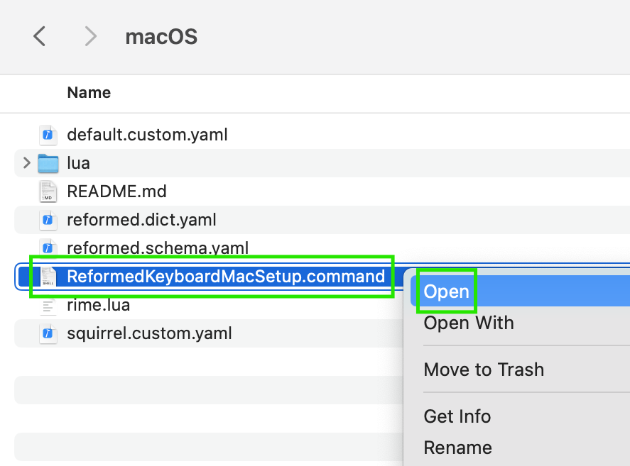

In the security pop-up, click `Open`

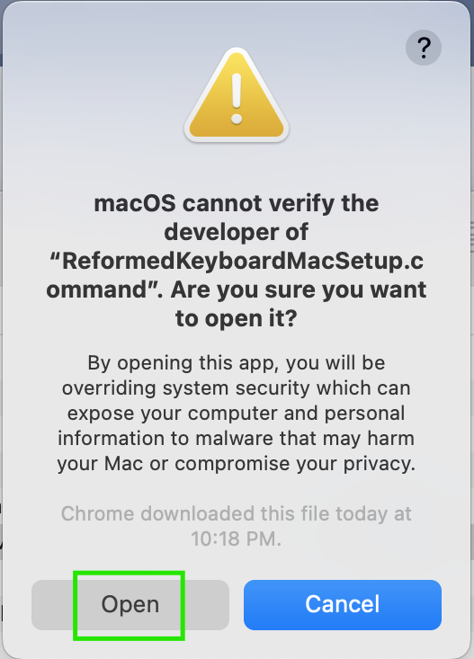

Follow the prompts shown in the opened Terminal window. Specifically, enter the password you log in to your Mac with and press `Return` or `Enter` key when prompted

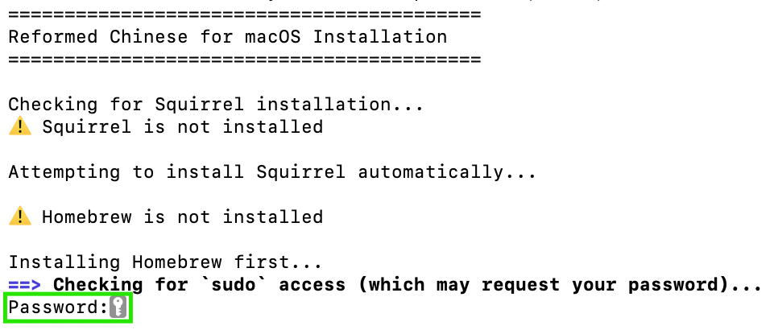

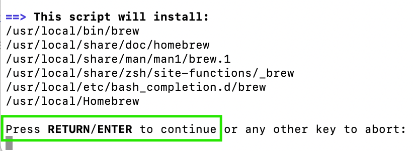

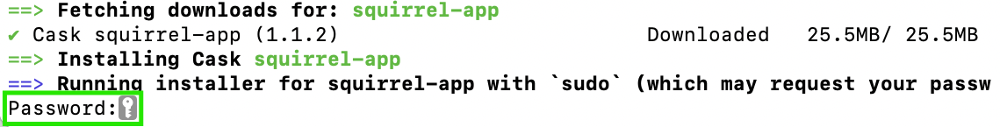

You should see below screenshot in Terminal window once the installation completes

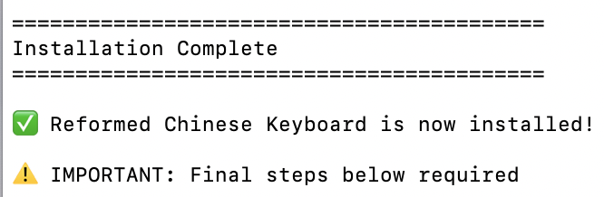

### Step 3: Add Squirrel to Input Sources

Click the Apple icon () in top-left corner of your screen and access `System Settings...`

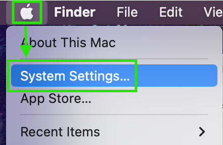

Go to `Keyboard` and next to `Input Sources`, click `Edit`

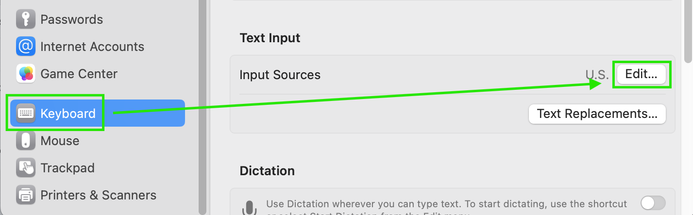

Click the `+` button

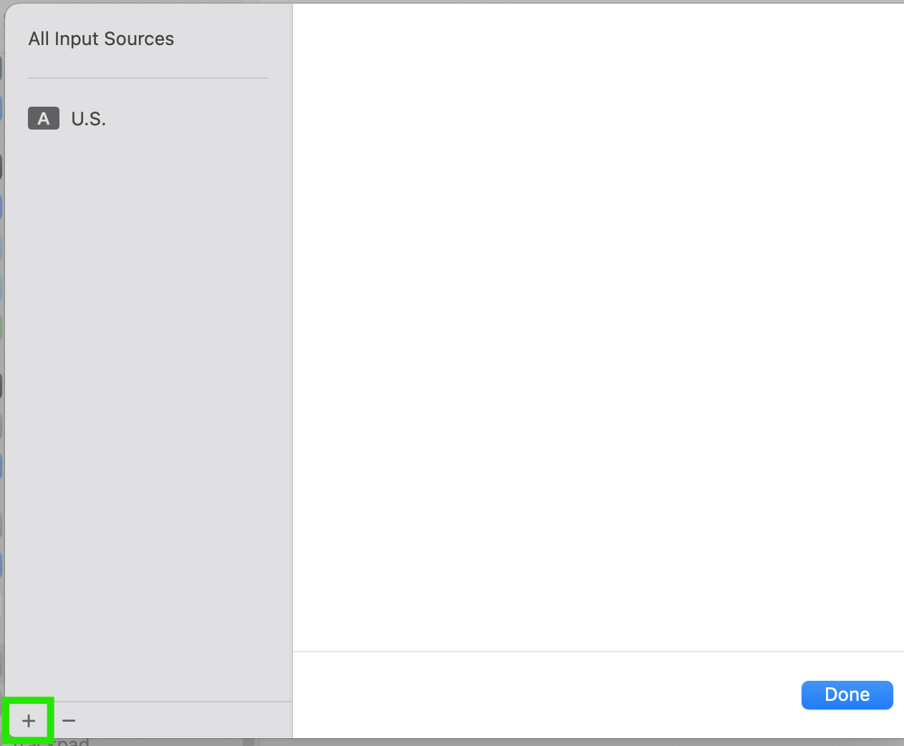

Search "Squirrel", you will see `Squirrel - Simplified` and `Squirrel - Traditional`. Select either one (`Simplified` and `Traditional` are misleading as keyboard is actually Reformed Chinese) and click `Add`  → `Done`

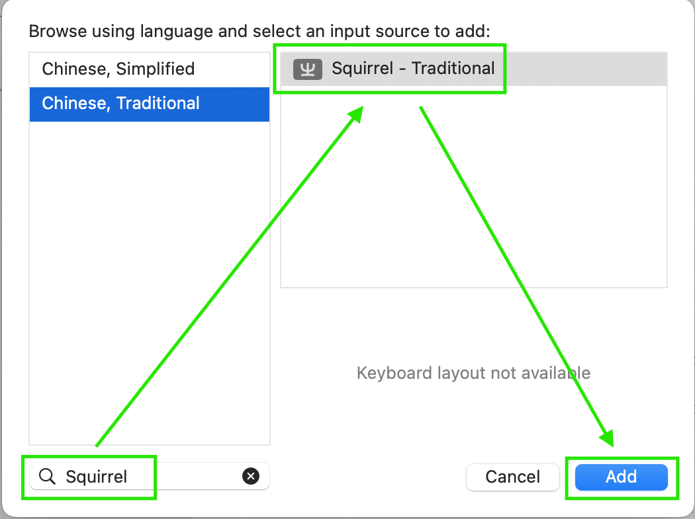

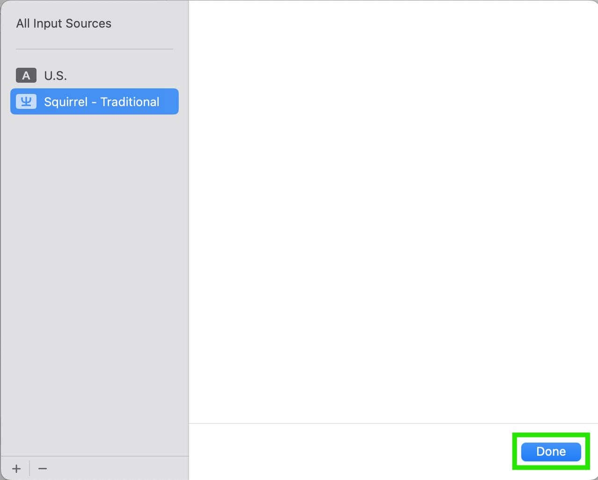

### Step 4: Log out and log in

Log out of your Mac and then log back in

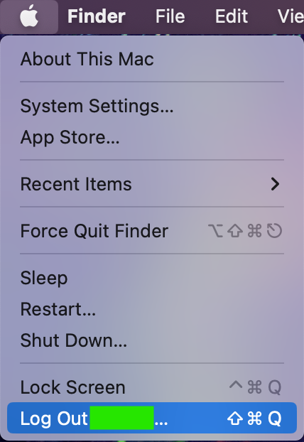

### Step 5: Verify Squirrel

Click the Input menu in top-right corner of your screen. Select `Squirrel`

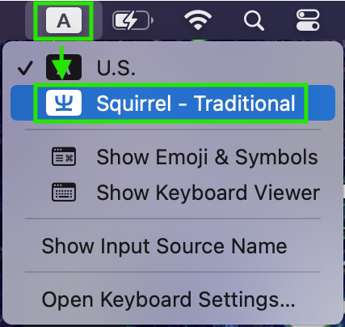

Type some 拼音 Pinyin to verify you can output Reformed Chinese characters e.g. "jidianzhong" for 几点鈡, "zhunbeihao" for 準俻好, "guandimiao" for 関帝庿. Enter the number on left of characters to output. If needed, press - or = keys to shortcut page through candidate characters

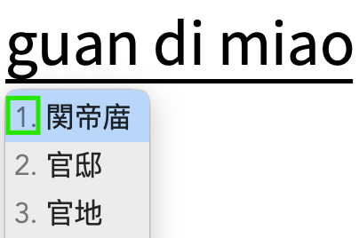

If you're able to output Reformed Chinese characters such as in screenshot above, CONGRATULATIONS! You have verified you can type Reformed Chinese characters, here's a [list of other Reformed characters](https://docs.google.com/spreadsheets/d/1lK39EUCqPZukM4NCPzidQg1L0zzKc6zavR6WR9Z6XZQ/) you can try typing 🥳 Woo!

## Toggling Lookalike Characters

Reformed Chinese keyboard can optionally output similar-looking characters or variants to substitute some Reformed characters that lack Unicode support and thus wouldn't display e.g. 亀 for [⿱⺈⿻口电](https://glyphwiki.org/glyph/u2ffb-u20ba5-u7535.svg) (Traditional: 龜)、誏 for [⿰訁上]( https://glyphwiki.org/glyph/u33069-uk.svg) (Traditional: 讓)、㒷 for [⿱丿㒷]( https://glyphwiki.org/glyph/u2a94c-var-002.svg) (Traditional: 興)

To toggle lookalike features:
1. With Squirrel selected, press `Control`**+**`` ` `` to see lookalike options. Left-side shows what is currently enabled or disabled, press the corresponding number (`2` or `3`) to toggle a feature

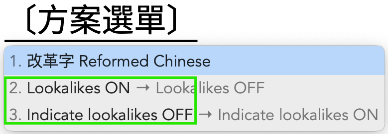

2. Enable or Disable:
   - **Lookalikes** (Default `ON`): If `OFF`, outputs corresponding Traditional characters instead. In cases where I couldn't find a suitable lookalike, will output Traditional regardless

      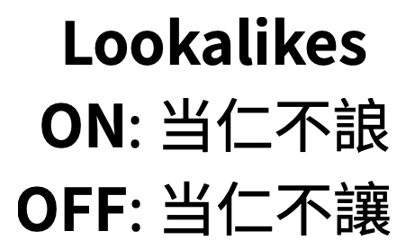

   - **Indicate Lookalikes** (Default `OFF`): Shows `ᴸ` marker after each lookalike. **Requires** `Lookalikes ON` to function

      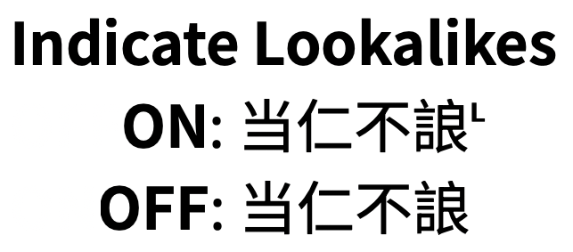