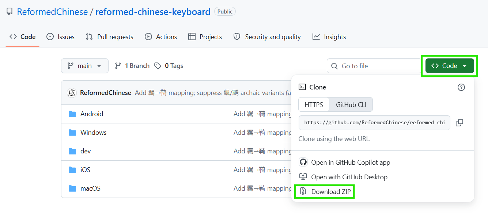

# Reformed Chinese Keyboard - macOS Installation Guide

### Step 1: Download this GitHub repo

On this GitHub repo [reformed-chinese-keyboard](https://github.com/ReformedChinese/reformed-chinese-keyboard), click the green `Code` button and then click `Download ZIP`

Double-click the downloaded `reformed-chinese-keyboard-main.zip` file to extract it

### Step 2: Run installation

In your extracted `reformed-chinese-keyboard-main` folder, go into `macOS` subfolder and double-click `ReformedKeyboardMacSetup.command` which will open a Terminal to install Reformed Chinese keyboard for you (specifically Homebrew and 鼠鬚管 Squirrel). Follow the prompts shown in Terminal

### Step 3: Add Squirrel to Input Sources

When the Terminal program finishes running, open **System Settings** and go to **Keyboard → Input Sources**. Click the **`+`** button

Search and add **Squirrel** (either `Squirrel - Simplified` or `Squirrel - Traditional` works, there's no difference to Reformed Chinese keyboard)

### Step 4: Log out and log in

You must log out of your Mac and then log back in

Select Squirrel from your input sources in menu bar

Now you can type 拼音 pinyin to output Reformed Chinese characters 🥳

## Toggling Lookalike Characters

Reformed Chinese keyboard can optionally output similar-looking characters or variants to substitute some Reformed characters that lack Unicode support and thus wouldn't display e.g. 亀 for [⿱⺈⿻口电](https://glyphwiki.org/glyph/u2ffb-u20ba5-u7535.svg) (Traditional: 龜)、誏 for [⿰訁上]( https://glyphwiki.org/glyph/u33069-uk.svg) (Traditional: 讓)

To toggle lookalike features:
1. In Reformed Chinese keyboard, press **Control** + **`**
2. Enable or Disable:
   - **Lookalikes** (Default ON): If OFF, outputs corresponding Traditional characters instead. In cases where I couldn't find a suitable lookalike, will output Traditional regardless
   - **Indicate Lookalikes** (Default OFF): Shows ᴸ marker after lookalikes, requires Lookalikes ON to function

**For Squirrel (鼠鬚管) - macOS Rime implementation**

## Quick Installation (Automatic)

**Just double-click `ReformedKeyboardMacSetup.command`**, it does everything automatically!

The installer will:
- ✅ Install Squirrel (via Homebrew) if not present
- ✅ Copy all Reformed Chinese files to the correct locations
- ✅ Set Reformed Chinese as your default input method
- ✅ Redeploy Squirrel automatically

**Installation takes 2-3 minutes.**

> **Note:** After a fresh Squirrel install you must manually add it to Input Sources once (see Step 4 below), then log out and back in for it to appear in the menu bar.

## Step-by-Step

1. **Download this repository** (as ZIP or clone with Git)
2. **Navigate to the `macOS` folder**
3. **Double-click `ReformedKeyboardMacSetup.command`**
4. **Add Squirrel to Input Sources** (required once after a fresh Squirrel install):
   1. Open **System Settings → Keyboard → Input Sources**
   2. Click the **`+`** button
   3. Search for **Squirrel** and add **Squirrel - Traditional** (or Simplified, either works)
   4. **Log out of macOS and log back in**.  Squirrel will now appear in the menu bar
5. **Start typing!**
   - Select Squirrel from your input sources (menu bar)
   - Press **Shift** to toggle between English/Chinese
   - Type pinyin to get Reformed Chinese characters

## Quick Start Guide

- **Switch mode**: Press **Shift** to toggle Chinese ⇄ English
- **Access menu**: Press **Control+`** for more options
- **View candidates**: Use number keys (1-9) to select characters
- **Page through options**: Use **-** and **=** keys

## Toggling Lookalike Characters

Reformed Chinese includes optional lookalike characters for traditional characters without proper Reformed Unicode support.

To toggle lookalike features:
1. While typing, press **Control+`** to open the menu
2. Find switches:
   - **Use Lookalikes** (使用形似字) - Toggle lookalike substitution (Default: ON)
   - **Indicate Lookalikes** (標示形似字) - Show ᴸ marker after lookalikes (Default: OFF)
