# Reformed Chinese Keyboard for Windows Installation Guide

### Step 1: Install Weasel

Access https://rime.im/download/. Under **Windows** section, `下載` download the latest compatible version of 小狼毫 Weasel

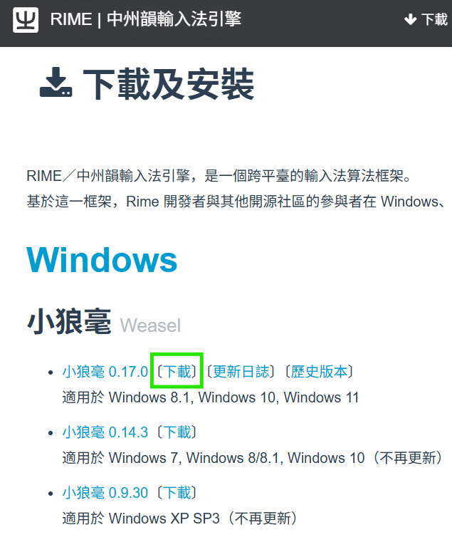

Open the downloaded Weasel installer .exe file e.g. weasel-0.17.0.0-installer.exe. Click `I Agree` → `Install`

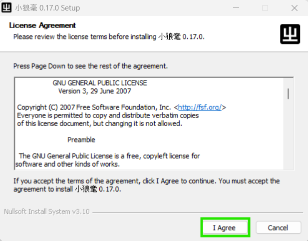

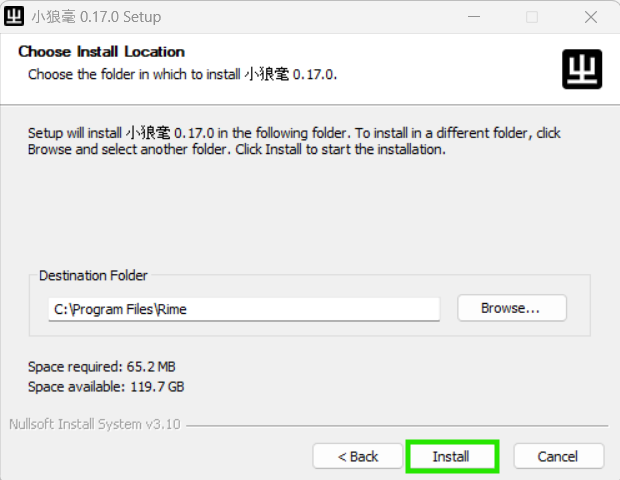

Under Schemas, ensure you have `改革字 Reformed Chinese` checkmarked. Click `OK`

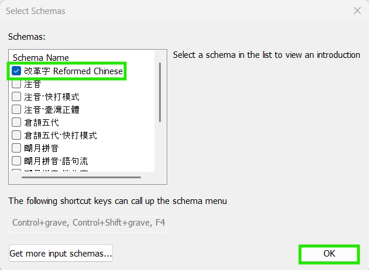

Choose a Weasel theme (I recommend `碧水／Aqua`) and click `OK`. Select whether you want automatic Weasel update checks, then click `Finish` to complete Weasel installation

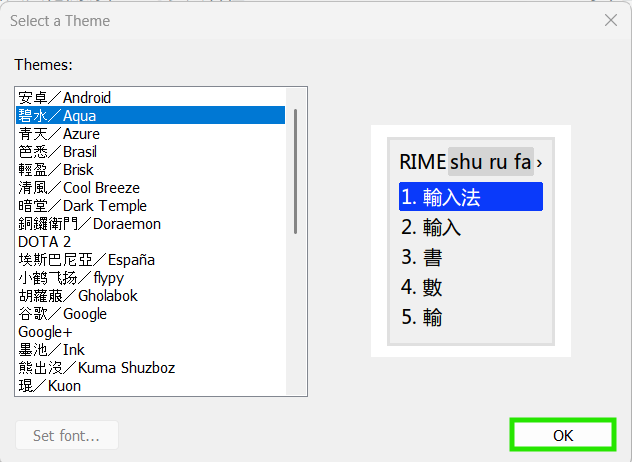

### Step 2: Download this GitHub repo

On this GitHub repo [reformed-chinese-keyboard](https://github.com/ReformedChinese/reformed-chinese-keyboard), click the green `Code` button and then click `Download ZIP`

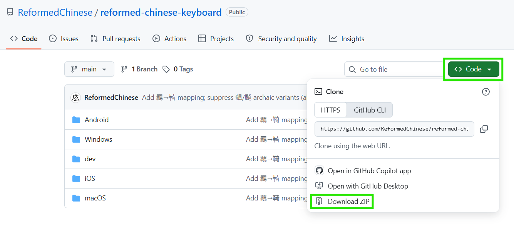

Extract the downloaded `reformed-chinese-keyboard-main.zip` file. If your version of Windows cannot extract and you need software, I suggest [7-Zip](https://www.7-zip.org/download.html)

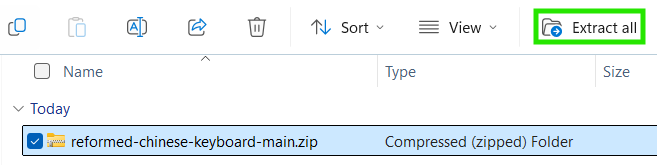

### Step 3: Install Reformed Chinese keyboard

Inside your extracted `reformed-chinese-keyboard-main` folder, go into `windows` subfolder and double-click `INSTALL_WINDOWS.bat` which installs Reformed Chinese keyboard for you

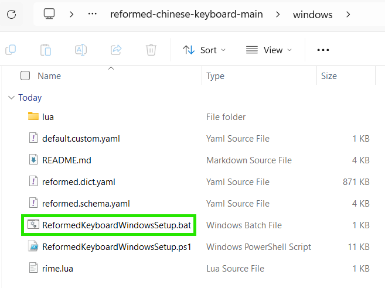

In the security pop-up, click `Run` to install Reformed Chinese keyboard

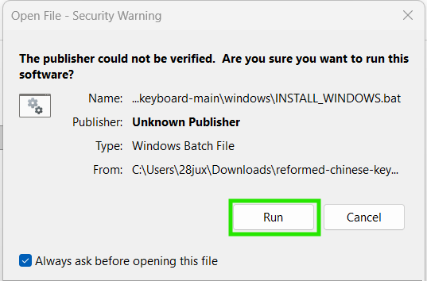

If successful, you will see below screenshot once the installation completes

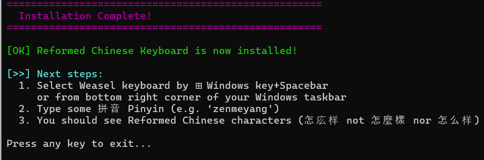

Select Weasel keyboard by `⊞ Windows key`**+**`Spacebar` or from bottom right corner of your Windows taskbar (Ignore `Traditional, Taiwan` as that is misleading, the keyboard is indeed Reformed Chinese not Traditional Chinese)

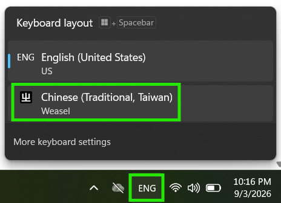

Type some 拼音 Pinyin to verify you can output Reformed Chinese characters e.g. "zenmeyang" for 怎庅样, "babaofan" for 八宝飯, "wangqiuchang" for 罔球場. Enter the number on left of characters to output. If needed, press `-` or `=` keys to shortcut page through candidate characters

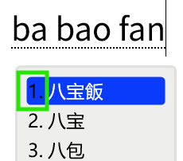

If you're able to output Reformed Chinese characters such as in screenshot above, CONGRATULATIONS! You have verified you can type Reformed Chinese characters, here's a [list of other Reformed characters](https://docs.google.com/spreadsheets/d/1lK39EUCqPZukM4NCPzidQg1L0zzKc6zavR6WR9Z6XZQ/) you can try typing 🥳 Woo!

## Toggling Lookalike Characters

Reformed Chinese keyboard can optionally output similar-looking characters or variants to substitute some Reformed characters that lack Unicode support and thus wouldn't display e.g. 亀 for [⿱⺈⿻口电](https://glyphwiki.org/glyph/u2ffb-u20ba5-u7535.svg) (Traditional: 龜)、誏 for [⿰訁上]( https://glyphwiki.org/glyph/u33069-uk.svg) (Traditional: 讓)

To toggle lookalike features:
1. With Reformed Chinese keyboard selected, press `Ctrl`**+**`` ` `` to see lookalike options. Left-side shows what is currently enabled or disabled, press the corresponding number (`2` or `3`) to toggle select feature

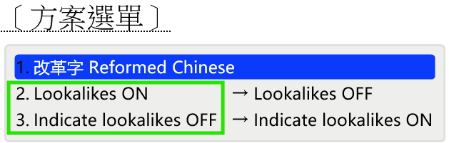

2. Enable or Disable:
   - **Lookalikes** (Default `ON`): If `OFF`, outputs corresponding Traditional characters instead. In cases where I couldn't find a suitable lookalike, will output Traditional regardless

      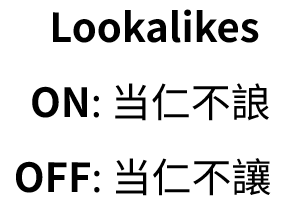

   - **Indicate Lookalikes** (Default `OFF`): Shows `ᴸ` marker after each lookalike. **Requires** `Lookalikes ON` to function

      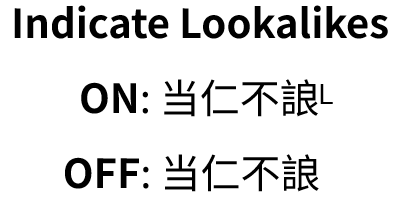
